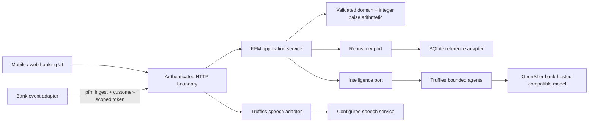

# Architecture

## Dependency boundaries

| Module | Responsibility |
|---|---|
| `domain.py` | Strict input schemas, INR formatting, categories, domain errors, redaction |
| `ports.py` | Repository and intelligence protocols |
| `service.py` | Ledger ingestion, summaries, budgets, goals, corrections, nudges and answers |
| `categorization.py` | Rule-first category policy, depending only on domain types |
| `intelligence.py` | Truffles agent construction, bounded JSON parsing, circuit breaker, local fallback |
| `repository.py` | SQLite storage, scoped reads/writes, transaction boundary, hash-linked audit |
| `security.py` | Demo sessions or RS256 identity verification, permissions, request throttling |
| `config.py` | Explicit runtime configuration, URL validation and secret-safe object representation |
| `api.py` | Composition root, API validation, auth, body limits, speech I/O and static UI |
| `seed.py` | Synthetic profiles for demo mode only |
| `static/` | Accessible responsive web UI, no provider keys or third-party scripts |

No LangChain, LangGraph, OpenAI SDK or other provider import appears in the PFM source.
A test enforces this. Those libraries remain implementation details of Truffles.

## Incoming transaction

1. Validate JWT/session and `pfm:ingest`; obtain bank/customer scope from verified credentials.
2. Validate posted transaction input. This endpoint is for a trusted bank adapter, not a
   client-submitted bank statement. It does not independently verify that a payment occurred.
3. Check event ID and canonical payload fingerprint. Exact retry returns the stored event;
   a changed payload with the same ID receives HTTP 409.
4. Categorise: trusted transaction kind → MCC → known merchant → consented AI suggestion → Other.
   The model receives only a redacted merchant name, never amounts, account details or the ledger.
5. Begin an immediate transaction and recheck idempotency to handle concurrent retries.
6. Validate refund references and limits; write transaction, audit and any eligible nudge together.
7. Return the persisted category, provenance, review flag, duplicate status and created nudges.

There is no external push delivery side effect. The stored nudge is the durable in-app notification.
Bank push/SMS channels should consume a transactional outbox in the production adapter, with
idempotent delivery, templates, channel consent and quiet-hours policy. No messages were sent
outside this demo.

## Chat

The model is an **intent router**, not a financial arithmetic engine. One stateless, tool-free
Truffles agent call returns a small JSON object with a whitelisted intent, category, month and
language. Pydantic rejects extra fields and malformed values. It never evaluates SQL or code.
The service then retrieves only the authenticated customer's records and renders a controlled
answer. No LLM-produced prose or numerical claim is delivered as financial fact.

The short conversation context stores the last structured intent for follow-ups. It does not
store the raw question or an unbounded transcript. Conversation and answer IDs are checked
inside bank/customer scope. APIs do not accept arbitrary customer IDs.

Each model request has a configurable timeout, no automatic SDK retries, a one-call agent
budget and a process-local concurrency ceiling of four. Three consecutive failures open a
30-second circuit breaker. Fallback is visible in every answer, and diagnostics expose only
counts, exception class and last call latency, not sensitive provider errors.

## Voice

Speech is a separate Truffles port: `speech_model(...).transcribe(...)` and `.speak(...)`.
Use a compatible audio endpoint or inject a custom adapter for a bank-owned ASR/TTS engine.
A chat model endpoint does not implicitly provide speech. Microphone input requires an explicit
user action and consent. The app buffers at most 2 MB, does not persist audio, validates accepted
MIME types and forwards audio to the configured provider. A MIME check is not content scanning.

Playback is restricted to a recently generated, customer-scoped answer ID. The endpoint cannot
be used as an arbitrary text-to-speech proxy. The UI identifies playback as AI generated.

## Storage and scale boundary

SQLite WAL is a local integration adapter. A process lock plus `BEGIN IMMEDIATE` protects
compound state changes. Transactions, goals, conversations, preferences and nudges have composite
bank/customer/resource keys. SQL uses bound parameters. The hash-linked audit is stored in the
same transaction as changes.

This is not a bank core ledger. It stores a PFM view of trusted posted events and does not hold
account balances, issue payment instructions or infer available balance. Production needs a
bank-managed database with RLS, indexed ledger tables, migrations, backup/PITR, independent audit
anchoring, distributed throttling and a monitored event integration. See the readiness document.
