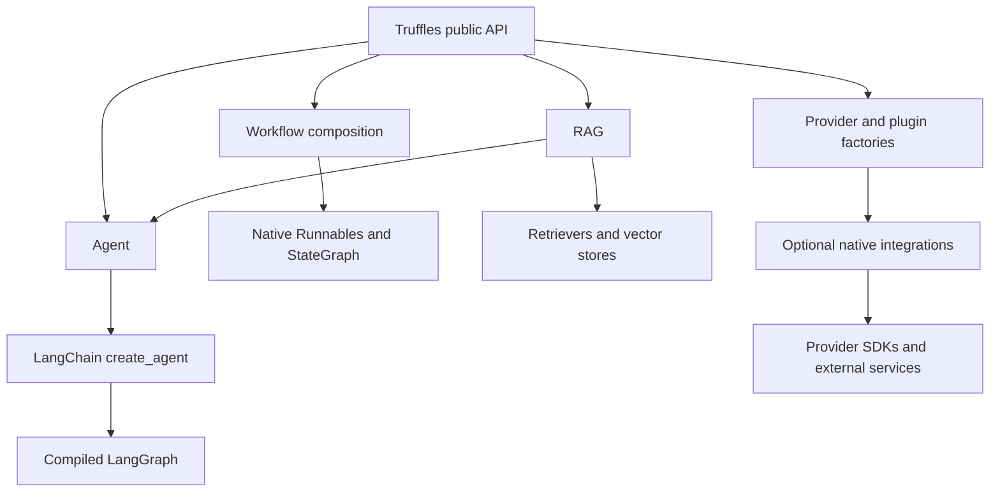

# Truffles project guide

## Purpose

Truffles provides a compact entry point for building AI agents and RAG systems.
A simple agent needs an import and a constructor call. More complex systems use
composable components with native escape hatches. The package wraps live provider
integrations; it does not host models, run an API proxy, or silently substitute
fake responses. Test doubles are explicitly imported from `truffles.testing`.

The central design choice is to keep LangChain's model, message, tool, document,
retriever and Runnable interfaces. LangGraph owns execution, checkpointing and
interruptions. This avoids implementing a second protocol for each provider and
keeps existing chains and graphs usable.

## Architecture

An agent normalizes input, constructs native runtime configuration, delegates the
run and exposes a `Result`. Its compiled graph remains available as `.native`.
A workflow returns a native Runnable. A vector-store factory returns the actual
integration object. This makes inspection, observability and advanced features
available without adding many wrapper methods.

## Main decisions

1. **Explicit provider identifiers.** `provider:model` avoids guessing a provider
   from a model name. Model IDs remain caller-controlled. Unknown chat provider
   names are delegated to LangChain's universal factory.
2. **Optional integrations.** The base install includes the agent runtime and text
   splitting. Provider SDKs, vector databases and embedding runtimes are extras.
   Merely importing `truffles` does not import LangChain or provider SDKs.
3. **Bounded execution.** Agents default to 20 model calls per invocation. Native
   middleware raises if the loop needs another call. Graph recursion is separately
   bounded. This is a request-count limit, not a token, time or dollar budget.
4. **Explicit state.** Default agents are stateless across calls. Memory requires
   an explicit thread identifier. Durable storage is a native checkpointer.
5. **Native contracts.** Options, filters, scores, tool schemas and provider errors
   retain their original meanings. There is no synthetic lowest-common-denominator
   API claiming all backends have the same capabilities.
6. **Simple RAG defaults.** Text-only RAG uses local BM25. Supplying embeddings
   selects dense retrieval. Advanced algorithms compose as native retrievers.
7. **Testability.** Offline doubles test behavior. Separate HTTP tests run real
   integration packages and SDKs against protocol-shaped stub responses.

## Supported architectures

Chat agents produce responses without local tools. ReAct agents repeatedly call
models and tools until the model finishes or the budget is exhausted. Sequential
workflows pass outputs between steps. Parallel workflows fan out and return named
outputs. Routers select one branch. Supervisors expose specialist agents as tools.

Plan/execute, reflection, voting, debate and handoff designs are combinations of
these primitives or native LangGraph nodes and edges. Truffles does not invent
separate agent classes for every prompt pattern. There is no claim that every
historical LangChain agent subclass can be reconstructed from a two-word option;
existing runnable chains and compiled graphs are accepted directly.

## Source organization

| Module | Responsibility |
| --- | --- |
| `__init__.py` | Lazy exports and package version |
| `agents.py` | Agent construction, invocation and native adapters |
| `results.py` | Answer text, messages, usage, structured data and sources |
| `providers.py` | Lazy model/embedding factories and registration |
| `workflows.py` | Native composition and supervisor construction |
| `stores.py` | Named native vector-store factories |
| `knowledge.py` | Chunking, indexing orchestration, retrieval and grounded generation |
| `retrieval.py` | BM25, RRF, query expansion and reranking adapters |
| `search.py` | Provider-hosted web search tools |
| `testing.py` | Explicit scripted model and deterministic lexical embeddings |

The `tests` directory separates runtime behavior, retrieval, factories and provider
wire contracts. `uv.lock` records dependency resolution, while `pyproject.toml`
declares the public dependency bounds and extras.

## Operational boundary

Truffles does not supply authentication for your application, tenancy policy,
hosted workers or a deployment platform. Tool functions run with your process's
permissions. Native tool validation checks argument shapes, not authorization.
Pass only tools you intend the agent to execute; use interruption middleware when
your application's workflow needs human approval.

Retrieved text is labeled as untrusted source data, but prompt wording alone is
not an injection-proof security boundary. RAG results expose candidate documents
so applications can inspect grounding. Generated citation numbers still need
application-specific evaluation.

## Delivery and verification

The repository includes the package, optional integrations, examples, tests,
Markdown documentation, CI configuration, dependency lock and build artifacts.
The [validation report](validation.md) records commands actually executed. Live
credentials were intentionally not used. Stub success verifies serialization and
runtime behavior, not account permissions, current model availability, quality,
rate limits or external service acceptance.
